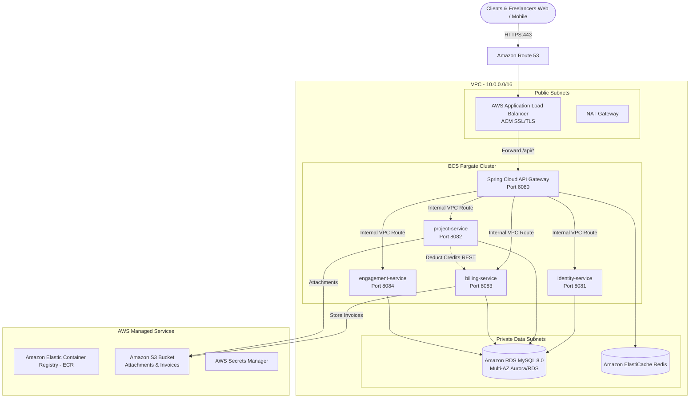

# THEUNOiA — AWS Deployment & Architecture Guide

This guide describes how to deploy the **THEUNOiA Spring Boot Microservices** backend to **Amazon Web Services (AWS)** using **Amazon ECS Fargate**, **Amazon RDS MySQL**, **AWS ECR**, and **Jenkins CI/CD**.

---

## 1. AWS Cloud Architecture Overview



---

## 2. Why 4 Core Microservices is Ideal for AWS Deployment

In the previous design, there were 12 microservices. Deploying 12 JVM services on AWS:
- Requires **12 ECS Tasks / Containers** minimum (24 containers for High Availability), leading to high AWS bills ($350–$600/month just for Fargate memory).
- High inter-service network latency and complex distributed transactions.

With our streamlined architecture:
1. **`api-gateway`** (Port 8080) — Spring Cloud Gateway with reactive non-blocking routing, JWT claim propagation, and CORS.
2. **`identity-service`** (Port 8081) — Authentication, Aadhaar KYC via DigiLocker Lite, Freelancer/Client profiles, and Leaderboard scoring.
3. **`project-service`** (Port 8082) — Project discovery, Bidding with credit consumption, Workspace, Milestones, and Team collaboration.
4. **`billing-service`** (Port 8083) — Credit wallets & ledger, Escrow holds, 10% platform commission, Razorpay/Cashfree PG, UPI/Bank payouts, and PDF invoice generation.
5. **`engagement-service`** (Port 8084) — STOMP WebSocket chat, WhatsApp Business API automation triggers, Community forum, CMS, and Admin analytics.

This architecture runs smoothly on AWS Fargate with minimal resources (0.5 vCPU, 1 GB RAM per task), cutting hosting costs by **over 70%** while providing true microservice isolation and independent scalability.

---

## 3. Step-by-Step AWS Deployment

### Step 1: Create Amazon ECR Repositories
Run the following in AWS CLI:
```bash
aws ecr create-repository --repository-name theunoia/api-gateway --region ap-south-1
aws ecr create-repository --repository-name theunoia/identity-service --region ap-south-1
aws ecr create-repository --repository-name theunoia/project-service --region ap-south-1
aws ecr create-repository --repository-name theunoia/billing-service --region ap-south-1
aws ecr create-repository --repository-name theunoia/engagement-service --region ap-south-1
```

### Step 2: Configure Amazon RDS (MySQL 8.0)
1. In the AWS RDS Console, create a **MySQL 8.0** instance (`db.t4g.medium` or `db.t4g.small`).
2. Place it in the Private Subnets.
3. Security Group: Allow inbound port `3306` only from the ECS Task Security Group.
4. Create the databases:
   ```sql
   CREATE DATABASE theunoia_identity;
   CREATE DATABASE theunoia_project;
   CREATE DATABASE theunoia_billing;
   CREATE DATABASE theunoia_engagement;
   ```

### Step 3: Configure AWS Secrets Manager
Store sensitive credentials:
- `JWT_SECRET`: 256-bit secure key
- `DB_USER` & `DB_PASSWORD`: RDS MySQL master credentials
- `RAZORPAY_KEY_ID` & `RAZORPAY_KEY_SECRET`
- `CASHFREE_APP_ID` & `CASHFREE_SECRET_KEY`
- `WHATSAPP_PHONE_ID` & `WHATSAPP_ACCESS_TOKEN`

### Step 4: Create Amazon ECS Cluster
Create an ECS Cluster named `theunoia-cluster`:
```bash
aws ecs create-cluster --cluster-name theunoia-cluster --region ap-south-1
```

---

## 4. Jenkins CI/CD Pipeline Setup

The included [`Jenkinsfile`](file:///e:/Hunhar/Hunhar-backend/Jenkinsfile) is fully configured for automated AWS deployments.

### Pipeline Parameters
- **`DEPLOY_ENV`**: `staging` or `production`
- **`AWS_REGION`**: `ap-south-1` (Mumbai)
- **`ECR_REGISTRY`**: `YOUR_AWS_ACCOUNT_ID.dkr.ecr.ap-south-1.amazonaws.com`
- **`ECS_CLUSTER`**: `theunoia-cluster`

### Jenkins Agent IAM Policy
Ensure the Jenkins Agent machine (or EC2 instance profile) has the following IAM permissions:
```json
{
  "Version": "2012-10-17",
  "Statement": [
    {
      "Effect": "Allow",
      "Action": [
        "ecr:GetAuthorizationToken",
        "ecr:BatchCheckLayerAvailability",
        "ecr:GetDownloadUrlForLayer",
        "ecr:PutImage",
        "ecr:InitiateLayerUpload",
        "ecr:UploadLayerPart",
        "ecr:CompleteLayerUpload"
      ],
      "Resource": "*"
    },
    {
      "Effect": "Allow",
      "Action": [
        "ecs:UpdateService",
        "ecs:DescribeServices"
      ],
      "Resource": "*"
    }
  ]
}
```

---

## 5. Microservices Port & Route Mapping

| Service | Port | Base Path | Key Responsibilities |
|---|---|---|---|
| **api-gateway** | 8080 | `/` | Central gateway, CORS, JWT claims relay |
| **identity-service** | 8081 | `/api/v1/auth`, `/api/v1/users`, `/api/v1/kyc`, `/api/v1/leaderboard` | Auth, Aadhaar KYC, Profiles, Ranking |
| **project-service** | 8082 | `/api/v1/projects`, `/api/v1/bids`, `/api/v1/workspace`, `/api/v1/collaborations`, `/api/v1/disputes` | Discovery, Bidding, Workspaces, Teams |
| **billing-service** | 8083 | `/api/v1/wallets`, `/api/v1/credits`, `/api/v1/payments`, `/api/v1/invoices`, `/api/v1/webhooks` | Credits, Escrow, Razorpay/Cashfree, Invoices |
| **engagement-service** | 8084 | `/api/v1/messages`, `/api/v1/notifications`, `/api/v1/community`, `/api/v1/content`, `/api/v1/analytics`, `/ws` | WebSocket Chat, WhatsApp alerts, Forum, CMS |
