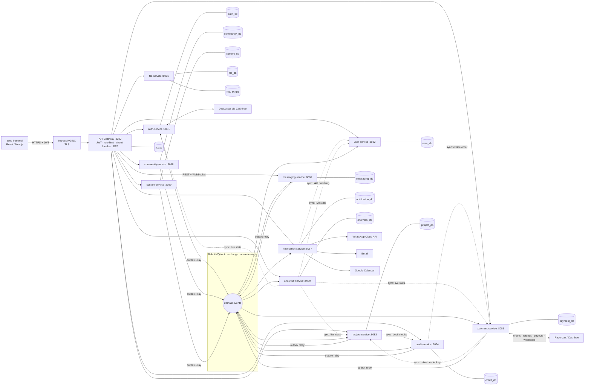

# THEUNOiA Backend — Spring Boot Microservices

Backend for **THEUNOiA**, a freelancing and collaboration marketplace. Clients post projects, freelancers bid with credits, and both sides work in a shared workspace with milestones, chat, escrow payments, invoices, and a community forum. Admins control everything from an admin API.

This repository implements **every backend module of the MVP technical breakdown**: Public Website CMS, Authentication (email, Aadhaar via DigiLocker, admin approval), Freelancer and Client modules, Messaging, Credit System, Payment and Wallet (direct and platform payments, commission, payouts, refunds, invoices), Community Forum, Collaboration, Admin Panel APIs, Analytics, and all MVP integrations.

| Layer | Technology |
|---|---|
| Language / framework | Java 17, Spring Boot 3.3, Spring Cloud 2023 |
| API Gateway | Spring Cloud Gateway (JWT, Redis rate limiting, Resilience4j circuit breakers, BFF aggregation) |
| Database | **PostgreSQL 16**, one database per service; Flyway migrations; **PL/pgSQL** functions and triggers |
| Messaging | RabbitMQ (topic exchange) + Transactional Outbox + idempotent consumers + DLQs |
| Cache / rate limit | Redis |
| Object storage | S3-compatible (MinIO locally, Amazon S3 in production) |
| Real-time | WebSocket / STOMP (messaging-service), fanned out across pods via RabbitMQ |
| Containers | Docker (one multi-stage, layered, non-root image definition for all services), Docker Compose |
| Orchestration | Kubernetes + Kustomize (base, staging, production overlays), HPA, PDB, NetworkPolicies, Ingress + TLS |
| CI/CD | Jenkins declarative pipeline (test, quality gate, parallel image builds, scan, staged deploy, approval, auto-rollback) |
| Integrations | Razorpay (orders, webhooks, refunds, RazorpayX payouts), Cashfree PG, Cashfree DigiLocker (Aadhaar), WhatsApp Business Cloud API, Google Calendar (OAuth2), SMTP email, S3 |

---

## 1. Architecture



### Microservices

| Service | Port | Database | Responsibilities (MVP modules) |
|---|---|---|---|
| **api-gateway** | 8080 | Redis | Single entry point, routing, JWT validation, header-spoofing protection, suspended-user deny-list, per-user/IP rate limits, circuit breakers + fallback, CORS, `/api/v1/dashboard/{freelancer,client}` aggregation |
| **auth-service** | 8081 | auth_db | Freelancer and client registration, login with lockout, JWT access tokens + rotating refresh tokens with reuse detection, email verification, password reset, **Aadhaar KYC via DigiLocker**, admin approval, rejection, suspension, audit log |
| **user-service** | 8082 | user_db | Freelancer profile (skills, experience, portfolio, certifications), client company profile, public search, **ranking system / leaderboard** (PL/pgSQL scoring) |
| **project-service** | 8083 | project_db | Project creation, publishing, cancellation, **full-text project discovery**, **bidding** (credit-consuming saga), bid comparison, shortlist, award, **workspace** (milestones, deliverables, progress updates), **collaboration teams**, two-way reviews, **disputes** |
| **credit-service** | 8084 | credit_db | Credit wallets and an immutable ledger, starter credits, bid debits and refunds, credit packages and purchase, admin allocation |
| **payment-service** | 8085 | payment_db | Razorpay/Cashfree orders and webhooks, **escrow**, **commission + GST**, wallet, **withdrawals (Bank/UPI via RazorpayX)** with admin approval, refunds, **direct payments**, **invoices (PDF)**, transaction logs |
| **messaging-service** | 8086 | messaging_db | One-to-one and project-based chats, attachments, unread counts, real-time WebSocket (STOMP), typing indicators, response-rate stats |
| **notification-service** | 8087 | notification_db | In-app notifications, email, **WhatsApp alerts and reminders**, **Google Calendar** (meetings, deadlines, payment reminders), reminder scheduler, promotional campaigns |
| **community-service** | 8088 | community_db | Discussions, Q&A with accepted answers, industry topics, tags, votes, reports and moderation, freelancer networking (follow) |
| **content-service** | 8089 | content_db | Public website CMS: dynamic landing pages, blog with categories and tags, **SEO metadata**, sitemap.xml, scroll-based recommendations, FAQ, contact form, lead collection |
| **analytics-service** | 8090 | analytics_db | Event-sourced metrics (users, active users, registrations, projects, revenue, commission, pending payments, top freelancers, growth trends) |
| **file-service** | 8091 | file_db + S3 | Uploads with validation, quota, and checksum to S3/MinIO; presigned downloads |

---

## 2. Database: why PostgreSQL, and how it is used

The spec named MySQL. As requested, the system uses **PostgreSQL 16** and pushes integrity rules into the database with **PL/pgSQL**:

* **ACID money handling.** Wallets, escrow, credits, and invoices need strict transactions, `NUMERIC(14,2)` exact arithmetic, row locks (`SELECT … FOR UPDATE`), and `FOR UPDATE SKIP LOCKED` for multi-pod workers.
* **Built-in full-text search.** Generated `tsvector` columns with GIN indexes power project discovery, forum search, and blog search without running Elasticsearch in the MVP.
* **JSONB** stores flexible data (landing-page sections, attachments, lead metadata) next to relational data.
* **Partial and expression indexes** encode business rules, for example "a milestone can be captured only once" or "one open dispute per project".
* **PL/pgSQL triggers and functions** keep derived data correct whichever code path writes it.
* **Database-per-service.** Each service owns its own database and a least-privilege role (`docker/postgres/init-databases.sh`), so services can't reach into each other's tables. Cross-service data flows only through APIs and events.

PL/pgSQL objects in the schema:

| Database | Object | Purpose |
|---|---|---|
| all | `set_updated_at()` trigger fn | audit timestamps |
| auth_db | `purge_expired_auth_tokens()` | nightly token housekeeping |
| user_db | `compute_freelancer_score()` + trigger | leaderboard score from ratings (Bayesian), volume, revenue (log), success rate, response rate |
| project_db | `trg_bids_maintain_count()` | live bid counter on projects |
| credit_db | `apply_credit_transaction()` | **atomic, idempotent, non-negative** credit debit/credit + ledger row; append-only ledger trigger |
| payment_db | `next_invoice_number()` | gap-free invoice numbers per Indian financial year (`TNU/2026-27/000042`); append-only money ledger trigger |
| messaging_db | `trg_messages_touch_conversation()` | conversation ordering and preview |
| community_db | `trg_votes_apply()`, `trg_replies_counter()` | exact vote scores and reply counts |
| content_db | `trg_blog_reading_time()` | reading time and publish timestamp |
| analytics_db | `record_metric()` + materialized view `monthly_metrics` | atomic metric upserts and monthly roll-ups |
| file_db | `user_storage_bytes()` | storage quota |

Full table-level documentation: **[docs/DATABASE.md](docs/DATABASE.md)**.

---

## 3. Communication patterns

**Synchronous (REST).** Clients only ever call the gateway (`/api/v1/**`). Services call each other directly inside the cluster on `/internal/**` endpoints. The gateway blocks those endpoints from the internet, and every service rejects requests that lack the shared `X-Internal-Token` (zero-trust). NetworkPolicies restrict the traffic as well.

**Asynchronous (events).** A state change and its event are written in **one DB transaction** (Transactional Outbox, `outbox_events` table). A relay publishes them to the `theunoia.events` topic exchange with publisher confirms. Consumers record each event id in `processed_events` within their own transaction, which gives exactly-once *effects* on top of at-least-once delivery. Failures are retried with backoff and then dead-lettered to `<service>.events.dlq`.

Event catalogue (excerpt):

| Event | Producer | Consumers |
|---|---|---|
| `user.registered` | auth | user (profile), credit (starter credits), notification (welcome + contact projection), analytics |
| `auth.email_verification_requested`, `auth.password_reset_requested` | auth | notification (email) |
| `user.kyc_verified`, `user.approved`, `user.rejected`, `user.suspended` | auth | user, notification (WhatsApp/email), analytics |
| `project.published` | project | notification (**new project matches** → WhatsApp), analytics |
| `bid.submitted`, `bid.shortlisted` | project | notification (**new bid received**), analytics |
| `project.awarded` | project | messaging (project chat), notification (**project awarded** + calendar deadline), analytics |
| `milestone.created` | project | notification (deadline + **payment reminder** calendar entries) |
| `milestone.approved` | project | payment (**escrow release**) |
| `payment.captured` | payment | project (milestone FUNDED), credit (purchase completion), notification, analytics |
| `escrow.released` / `escrow.refunded` | payment | project (PAID / REFUNDED), user (revenue → ranking), notification (**payment received**), analytics |
| `dispute.resolved` | project | payment (refund / release / split) |
| `bid.refund_requested` | project | credit |
| `review.created`, `project.completed`, `messaging.response_stats` | project / messaging | user (ranking) |
| `invoice.generated` | payment | notification (**email copy**) |
| `message.sent` | messaging | messaging (WebSocket fan-out to every pod), notification, analytics |

---

## 4. Key business flows

**Registration and verification:** register (freelancer: name, email, mobile, password, skills, portfolio; client: company, contact person, email, mobile, password) → email verification → Aadhaar via DigiLocker (only the last 4 digits are stored) → `PENDING_APPROVAL` → admin approves → `ACTIVE`, with a WhatsApp alert.

**Bidding (saga):** the bid costs credits based on the project's budget tier. project-service debits credit-service with an idempotency key, persists the bid plus its event, and refunds automatically if persistence fails. A cancelled open project refunds every bidder through an event.

**Platform payment (escrow):**
```
client funds milestone → Razorpay/Cashfree order → webhook (HMAC verified, de-duplicated) → escrow HELD
→ freelancer submits work → client approves → escrow released:
   10,000.00 gross − 10% commission (1,000.00) − 18% GST on commission (180.00) = 8,820.00 to wallet
→ invoices: payment receipt (client), commission tax invoice (freelancer)
→ withdrawal (Bank/UPI) reserves funds → admin approves → RazorpayX payout → webhook → COMPLETED (+ payout statement)
```
**Direct payment:** the client records an off-platform payment and the freelancer confirms it. It counts toward revenue for ranking, and no commission is charged.

**Disputes:** the admin resolves with `REFUND_CLIENT`, `RELEASE_TO_FREELANCER`, `SPLIT` (with a percentage), or `NO_ACTION`, and payment-service executes the money movement.

---

## 5. Security

* HS256 JWT access tokens (15 min) validated at the gateway. Refresh tokens are opaque, stored only as SHA-256 hashes, and rotated on every use; replaying one revokes the whole token family.
* BCrypt(12) passwords, account lockout after 5 failures, and strict rate limits on login and registration.
* The gateway strips any client-supplied `X-User-*` and `X-Internal-Token` headers, so they can't be spoofed. Suspended users are blocked immediately through a Redis deny-list.
* Method-level authorization (`@PreAuthorize("hasRole('CLIENT') and hasAuthority('STATUS_ACTIVE')")`) plus ownership checks in the service layer.
* AES-256-GCM encryption at rest for bank account numbers and Google refresh tokens. Full Aadhaar numbers are never stored.
* Webhooks are authenticated by HMAC over the raw body using constant-time comparison.
* File uploads use a content-type allowlist, a size limit, per-user quota, filename sanitising (path traversal), and SHA-256 checksums.
* Containers run as non-root UID 1001 with a read-only root filesystem, all capabilities dropped, seccomp `RuntimeDefault`, default-deny NetworkPolicies, and Pod Security Admission.

---

## 6. Running it

> **Quick start (Windows):** `.\run.ps1 start` starts everything, `.\run.ps1 demo` runs the full business flow, and `.\run.ps1 stop` stops it.
> Every procedure (tests, Docker Compose, IDE, Kubernetes, Jenkins, troubleshooting) is in **[DEPLOYMENT.md](DEPLOYMENT.md)**.

### Prerequisites
JDK 17, Maven 3.9+, and Docker. Kubernetes deployment also needs kubectl and kustomize.

### Build and test (no external services needed)
```bash
mvn clean verify
```
Integration tests start an **embedded PostgreSQL**, run the real Flyway migrations and PL/pgSQL, and exercise each service end to end: auth lifecycle, project lifecycle, credit concurrency (no overdraft with 10 parallel bids), escrow and commission math, chat, notifications and reminders, community, CMS, analytics, file uploads, and gateway security.

### Full stack with Docker Compose
```bash
cp .env.example .env
docker compose up -d --build
```
| URL | What |
|---|---|
| http://localhost:8080 | API gateway (all `/api/v1/**` calls) |
| http://localhost:15672 | RabbitMQ console (theunoia / theunoia) |
| http://localhost:9001 | MinIO console |
| http://localhost:8025 | MailHog (verification and invoice emails land here) |
| http://localhost:808X/swagger-ui.html | Each service's OpenAPI UI (direct access, dev only) |

Quick walkthrough (payments run in **mock** mode locally):
```bash
# 1. register a client, then read the verification link from MailHog and POST its token to /api/v1/auth/verify-email
curl -X POST localhost:8080/api/v1/auth/register/client -H 'Content-Type: application/json' -d '{"companyName":"Acme Pvt Ltd","contactPerson":"Ravi","email":"ravi@acme.in","mobile":"9876543210","password":"Secret123"}'
# 2. login -> accessToken
curl -X POST localhost:8080/api/v1/auth/login -H 'Content-Type: application/json' -d '{"email":"ravi@acme.in","password":"Secret123"}'
# 3. Aadhaar (mock DigiLocker): POST /api/v1/auth/kyc/aadhaar/initiate, then GET /api/v1/auth/kyc/aadhaar/status
# 4. admin (admin@theunoia.com / Admin@12345) approves: POST /api/v1/admin/users/{id}/approve
# 5. POST /api/v1/projects  ->  freelancer POST /api/v1/projects/{id}/bids  ->  POST /api/v1/bids/{bidId}/award
# 6. POST /api/v1/payments/orders {milestoneId}  ->  POST /api/v1/payments/mock/{orderId}/capture
```
The complete endpoint list is in **[docs/API.md](docs/API.md)**.

### Kubernetes
```bash
kubectl create namespace theunoia-staging
kubectl -n theunoia-staging create secret generic theunoia-secrets --from-env-file=secrets.env   # keys: k8s/secrets.example.yaml
kubectl apply -k k8s/overlays/staging
```
* `k8s/base` holds the namespace, ConfigMap, in-cluster PostgreSQL/RabbitMQ/Redis/MinIO, the **db-provisioner Job** (creates the per-service databases and roles idempotently), 12 Deployments with startup, readiness, and liveness probes, HPA (CPU and memory), PDB, Ingress (TLS, WebSockets), and NetworkPolicies.
* `k8s/overlays/staging` uses single replicas, sandbox integrations, and staging hosts.
* `k8s/overlays/production` swaps in managed PostgreSQL (RDS Multi-AZ) and S3 instead of in-cluster pods, gives more resources to the money paths, and raises the HPA ceilings.
* Service manifests are generated by `python scripts/generate-k8s.py`. Edit the generator, then regenerate.

### Jenkins CI/CD (`Jenkinsfile`)
Checkout → change detection (only rebuild modified services unless `common-lib`, the root POM, or the Dockerfile changed) → `mvn verify` with JUnit reports → optional SonarQube quality gate → **parallel** `docker buildx` builds with registry layer cache, immutable `<build>-<sha>` tags → Trivy scan (fails on CRITICAL) → deploy to staging (secret from the Jenkins credential store, `kustomize edit set image`, DB provisioning Job, rollout status with **automatic `rollout undo`** on failure) → smoke tests → manual approval → production.

---

## 7. Configuration and integrations

Everything is configured through environment variables (see `.env.example` and `k8s/configmap.yaml`). Each external integration has a provider switch with a **mock** for local development:

| Integration | Switch | Production settings |
|---|---|---|
| Razorpay checkout, webhooks, refunds | `PAYMENT_PROVIDER=razorpay` | `RAZORPAY_KEY_ID/SECRET`, `RAZORPAY_WEBHOOK_SECRET`; webhook URL `https://api…/api/v1/webhooks/razorpay` |
| Cashfree PG | `PAYMENT_PROVIDER=cashfree` | `CASHFREE_CLIENT_ID/SECRET`; webhook `…/api/v1/webhooks/cashfree` |
| RazorpayX payouts (Bank/UPI) | `PAYOUT_PROVIDER=razorpayx` | `RAZORPAYX_ACCOUNT_NUMBER`; payout webhooks to `…/webhooks/razorpay` |
| Aadhaar via DigiLocker (Cashfree) | `KYC_PROVIDER=cashfree` | `CASHFREE_CLIENT_ID/SECRET`, `KYC_REDIRECT_URL` |
| WhatsApp Business (Meta Cloud API) | `WHATSAPP_ENABLED=true` | `WHATSAPP_PHONE_NUMBER_ID`, `WHATSAPP_ACCESS_TOKEN`; create the approved templates listed in `WhatsAppSender` |
| Google Calendar | set `GOOGLE_CLIENT_ID` | `GOOGLE_CLIENT_SECRET`, redirect URI `…/api/v1/calendar/google/callback` |
| Email | SMTP | `SMTP_HOST/PORT/USERNAME/PASSWORD` (SES, SendGrid, …) |
| Cloud storage | S3 | `S3_ENDPOINT` empty means AWS; credentials via IRSA or `S3_ACCESS_KEY/SECRET` |
| Commission | `PLATFORM_COMMISSION_RATE` | default `0.10`; GST on commission `GST_RATE=0.18` |

> **Before going live:** the Razorpay, Cashfree PG/DigiLocker, Meta WhatsApp, and Google API calls follow those providers' documented contracts, but they were tested here only against the mock providers. Run each integration end to end in its sandbox and confirm the request and response fields against the provider's current API version.

---

## 8. Repository layout

```
theunoia-backend/
├── pom.xml                      # Maven reactor (Spring Boot 3.3 / Spring Cloud 2023)
├── common-lib/                  # security filters, error model, outbox + idempotent events, internal REST client, crypto
├── api-gateway/                 # Spring Cloud Gateway (reactive)
├── auth-service/ … file-service/  # 11 domain services: domain/, repository/, service/, web/, event/, db/migration/
├── Dockerfile                   # one parameterised image build for every service (--build-arg SERVICE=…)
├── docker-compose.yml           # complete local stack
├── docker/postgres/init-databases.sh
├── k8s/base | overlays/staging | overlays/production
├── Jenkinsfile
├── scripts/generate-k8s.py
└── docs/ API.md, DATABASE.md
```
